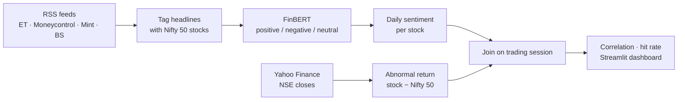

# Nifty News Sentiment

**Does the tone of today's financial news line up with how Indian stocks move?**

This project collects market headlines from Indian business news sites, tags each one with the Nifty 50 companies it mentions, scores its tone with [FinBERT](https://github.com/ProsusAI/finBERT), and compares that tone with each stock's market-adjusted return on the same day and the next day. A Streamlit dashboard shows the results stock by stock.

> Built on **ProsusAI/finBERT** (Apache-2.0) by Prosus AI ([paper](https://arxiv.org/abs/1908.10063)). The FinBERT model is theirs. The news pipeline, stock tagging, price alignment, analysis and dashboard here are my own work. See [NOTICE](NOTICE).

## How it works



What I added on top of FinBERT:

| Piece | What it does |
|---|---|
| `news.py` | Pulls headlines from 4 Indian market RSS feeds and tags them with 25 Nifty 50 companies using whole-word alias matching ("ITC" matches *ITC shares slip*, not *pitch*; "L&T" and "Larsen & Toubro" both map to LT). |
| Session alignment | NSE closes at 15:30 IST, so news after the close or on a weekend is assigned to the next trading session. News on exchange holidays rolls forward to the next real session. |
| `prices.py` | Daily NSE closes via `yfinance`. Each stock's return has the Nifty 50's return subtracted, so market-wide moves don't count as a reaction to company news. |
| `sentiment.py` | Loads FinBERT through Hugging Face `transformers` with batched GPU/CPU inference. The original repo uses the outdated `pytorch_pretrained_bert` library, and its authors list moving to `transformers` as a to-do. Each headline gets `score = P(positive) − P(negative)`, from −1 to +1. |
| `analysis.py` | Same-day and next-day correlation, a direction "hit rate" (0.50 = coin flip), and the average move on negative, neutral and positive news days. |
| `app.py` | Streamlit dashboard, plus a box to score any headline you type. |
| `collect.yml` | A GitHub Action that collects headlines every weekday at 18:15 IST, so the dataset grows on its own. RSS feeds only show the last day or two. |

## Run it

```bash
pip install -r requirements.txt

python run_pipeline.py collect     # fetch today's headlines into data/headlines.csv
python run_pipeline.py analyse     # FinBERT scores + prices + summary (first run downloads the ~440 MB model)
streamlit run app.py               # dashboard at http://localhost:8501
```

`analyse` writes `outputs/summary.json` and `outputs/daily_sentiment_vs_returns.csv`. It runs on a CPU; a few thousand headlines take a couple of minutes. On Kaggle or Colab, turn on a GPU and Internet and run the same commands.

Tests run offline (no model download, no network), with FinBERT replaced by a stub:

```bash
pytest -q
```

## Reading the results honestly

- **Same-day correlation** is the main number. Headlines often *report* a move ("Infosys jumps 4% on deal win"), so tone and same-day return are expected to agree. That shows FinBERT reads Indian market headlines correctly.
- **Next-day correlation** is the harder test of whether news tone *predicts* anything. Expect it to be close to zero; public headlines are priced in fast. A clearly positive value over a small sample is more likely noise than an edge.
- Results get more reliable as `collect` runs over more weeks. With only a few days of data, treat every number as a sanity check, not a finding.

## Project structure

```
src/nifty_sentiment/
  tickers.py     Nifty 50 symbols and the names headlines use for them
  news.py        RSS collection, stock tagging, trading-session mapping
  sentiment.py   FinBERT scorer (transformers) + headline scoring
  prices.py      NSE closes and market-adjusted returns
  analysis.py    daily aggregation, joins, correlation, hit rate
run_pipeline.py  collect / analyse / all
app.py           Streamlit dashboard
tests/           offline unit tests
```

## Licence

Apache-2.0, the same as FinBERT. See [LICENSE](LICENSE) and [NOTICE](NOTICE).
